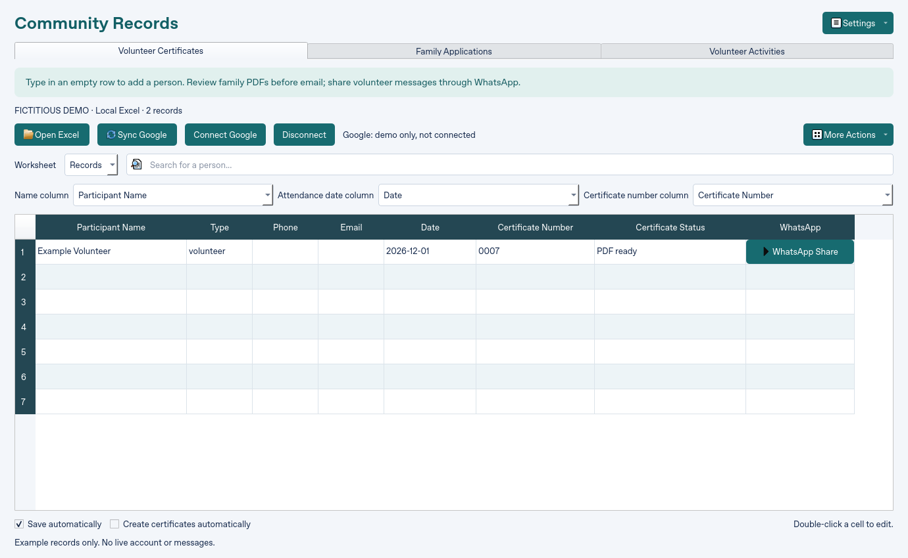

# Foodbank Community Admin

An English-language PySide6 desktop application using Excel as its database. Manage volunteers and beneficiary families; generate PDF certificates from PPTX templates; connect Google with desktop OAuth, sync two selected response Sheets, email family confirmation PDFs through Gmail after review, and open WhatsApp for manual volunteer sharing. No Streamlit or web server is required.

[中文负责人完整操作指南](OPERATOR_GUIDE_ZH.md) · [Validation and live acceptance limits](VALIDATION.md)



## Windows: first run in VS Code

Install Python 3.12 or 3.13 (64-bit), VS Code with Microsoft's Python extension, and Microsoft PowerPoint or LibreOffice Impress for PDF export. PowerPoint generally preserves PowerPoint template formatting most accurately.

Download or clone this repository and open its root folder in VS Code. Open **Terminal → New Terminal**, select **Command Prompt**, and run:

```bat
py --version
py -m venv .venv
.venv\Scripts\python.exe -m pip install -r requirements.txt
.venv\Scripts\python.exe main.py
```

For subsequent launches, run `.venv\Scripts\python.exe main.py` or double-click `run.bat`. The batch file also installs any missing dependencies.

## Try the sample workflow

1. Click **Open Excel** and select `examples/sample_records.xlsx`. The sample contains two fictitious records and no real phone numbers. Changes are saved to the selected workbook, so copy it first if you want to keep a pristine sample.
2. Click **Settings → Certificate Templates**. Select `examples/volunteer_sample.pptx`. Leave the name marker as `Name`. Above the volunteer table, select Participant Name, Date, and Certificate Number for the three certificate columns.
3. Select `powerpoint` (or `auto`) on Windows with PowerPoint installed. Without PowerPoint, select `libreoffice`; if necessary, enter `C:\Program Files\LibreOffice\program\soffice.exe` as the executable path.
4. Click **More Actions → Generate / Retry PDFs**. Volunteers should show **PDF ready**. Beneficiaries do not receive certificates.
5. Click **More Actions → Open PDF Folder** to inspect the output. Check fonts, layout, and long names before sending real certificates.
6. Type directly into one of the six empty rows at the bottom to enter another record. With **Save automatically** and **Create certificates automatically** checked, edits save about 1.4 seconds after typing stops and eligible certificates generate in the background.

Types are `volunteer` and `beneficiary`. Imported multilingual headings, names, and recognized type aliases are supported; user data is preserved as entered while application controls and messages are in English.

## Three workflow tabs

- **Volunteer Certificates**: volunteer records and PPTX certificate sharing.
- **Family Applications**: family responses and a complete confirmation PDF for the applicant to review.
- **Volunteer Activities**: volunteer responses and personalized activity messages.

Every tab uses the same Excel-style editing controls. Tabs filter the selected worksheet by record type; use the Worksheet selector to choose the relevant Google response or local worksheet. Each tab remembers its selected worksheet during the session. Volunteer certificate and activity tabs can deliberately use the same registrations, avoiding duplicated people.

Six empty entry rows remain at the bottom. Start typing in any of them to create a record; six new empty slots remain below it. The current tab supplies the type automatically when a Type column is mapped. Empty entry rows are not saved to Excel. If an imported sheet has no Type column, configure its default type in Worksheet Columns. Imported Google response rows remain read-only, but you can add manual records in the blank rows below them. Manual records are not sent back to Google.

**Family confirmation:** click the applicant’s **Review & Email** button in Family Applications. The app creates an A4 PDF containing every original question/answer, including unanswered fields. Check the read-only applicant email address, subject, message and **Open PDF Preview**. Tick the review confirmation and click **Send Email** to send the actual PDF attachment through the connected Gmail account. Cancel sends nothing; syncing never sends mail. This is a request to confirm/correct application details, **not an approval of assistance**. Files remain under `data/family_confirmations`; no PowerPoint or LibreOffice is needed for these PDFs. Upload/file answers retain their Sheet link/text; private file contents are not downloaded.

A durable, payload-free journal (`data/email_delivery.sqlite3`) reserves an attempt before sending. Repeated clicks are blocked. Any previous attempt requires a new review and explicit resend acknowledgement. Timeout, server failure or an interrupted attempt is **uncertain**: check Gmail **Sent** before resending. Sends have no automatic retry, including HTTP authentication retries; API-level exactly-once delivery is not claimed. Gmail accepting a send does not prove final recipient delivery. Do not delete the journal to clear warnings.

**Open Application Form** opens the supplied family form editor (requires the form owner's Google permissions):
https://docs.google.com/forms/d/1Z8bwgdGnaaTqHR5WCY-RQu0gD9v-o25xoUGByiqW2Ok/edit

A form editing URL is not a response spreadsheet URL. Open the form editor → Responses → green Google Sheets icon to obtain the linked Sheet URL. The owner has not provided that response Sheet or credentials yet, so live sync is not configured. Link the form to a Google Sheet, give the operator’s Google account access, and select it in the family panel of Google Sheets Connection. The form content has not been verified; no fixed question list is assumed: all response-sheet headings and values are preserved dynamically.

**Volunteer activity messages:** volunteer registrations come from **Tally → native Google Sheets integration → this app**, not direct Tally account access. Select the response Sheet and explicitly map the applicant’s **Attendance date column (not Timestamp)**. Click **Event Message** to save event, time, location, details and message template. Supported placeholders: `{name}`, `{phone}`, `{event}`, `{date}`, `{time}`, `{location}`, `{details}`. `{date}` is required and comes from **each applicant’s selected participation date**, never the old global date or the submission timestamp. For manual Excel records, explicitly choose **Activity participation date (not Timestamp)** in Worksheet Columns. Certificate date mappings are independent. Missing/invalid phone numbers or attendance dates block sharing. **WhatsApp Share** opens an editable preview; **Open WhatsApp** opens that person’s chat for manual sending. No automatic WhatsApp messages or attachments are sent.

Settings and advanced actions remain under **Settings** and **More Actions**. All interface text is English; participant data keeps its original language.

## Excel records and column mapping

The default database is `data/community.xlsx`. **Open Excel** can select an existing `.xlsx` or `.xlsm` workbook; its first row is treated as column headings. **Settings → Worksheet Columns** selects the participant name, type, phone, email, activity participation date, certificate attendance date, and certificate number columns. If a worksheet has no Type column, choose a default type for that worksheet.

Edit cells directly, press Tab to move between cells, search any field, switch workflow tabs, and paste multiple rows or columns from Excel with Ctrl+V. Ctrl+C copies selected cells. While a filter is active, paste fills existing visible rows; clear filters to paste additional rows.

This is a table editor, not a complete Excel replacement: it does not reproduce charts or merged-cell layouts or recalculate formulas. Unedited numeric, date, and formula cells retain their values. Newly entered text is stored as text rather than executed as a formula. Deleting rows may affect formula references or Excel tables.

The app adds hidden `__fb_id`, `__fb_source`, and `__fb_key` columns for stable record identity. Keep these columns and do not manually copy or change record IDs. Each actual write creates a backup in `<workbook_name>_backups`. Unchanged Google polling does not rewrite the workbook or create a backup. Backups do not expire automatically.

Saving uses a temporary file, atomic replacement, an application lock, and external modification checks. Use one administrator instance per workbook. If external changes conflict with unsaved edits, auto save pauses: copy your edits somewhere safe, then reload and resolve them. Close Excel if it locks the workbook. A stale `.foodbank.lock` file should only be removed after all app instances are closed.

## Certificate templates

The recipient name must be editable PPTX text, not text baked into an image. The default `Name` marker (and legacy `auto` setting) detects the standalone word `name` (case-insensitive) or `{{NAME}}`, including markers split across text runs. Alternatively, enter the exact text to replace. Text boxes, grouped shapes, table cells, and layout/master text are supported. Use the editable text **Date No** for attendance date and **Cert No** for certificate number. The main Volunteer Certificates screen has **Name column**, **Attendance date column**, and **Certificate number column** selectors. Each selection is saved per workbook/worksheet and applies to every record in that worksheet. Select columns, not individual row numbers.

Use the actual attendance date, not the form submission timestamp. Each certificate reads the name, attendance date and certificate number from the same person's row in the three selected columns. The app does not invent or auto-increment numbers; enter the correct unique certificate number for each registration in the source. Store numbers such as `0007` as Excel text to preserve leading zeros. All three editable template markers and all three row values are required: missing markers or blank values block export and reuse of an old PDF. Changing a date, number, or column selection invalidates the cached PDF.

Attendance dates stored as Excel date/time values or ISO timestamps print as `YYYY-MM-DD`, without `T00:00:00`; the source cell and unrelated timestamps remain unchanged. Certificate numbers are literal identifiers, including slash-separated values such as `26/06/3705`. If Excel has already converted a certificate number into a date, generation stops with an explanatory message: set the source cell format to **Text**, then **re-enter the exact number** and reload/sync. Changing only the format cannot restore the original identifier. You can also re-enter the correct number in an editable local worksheet in the app; it is saved as text.

**Updating an older installation:** the supplied template previously contained fixed sample values `July 18, 2026` and `26/06/3705`. Replace the bundled `templates/volunteer_template.pptx` with this corrected version, or change those two values to `Date No` and `Cert No` in your custom PPTX. Keep the surrounding labels/design. In **Settings → Certificate Templates**, select that corrected file, choose the three source columns above the volunteer table, then click **More Actions → Generate / Retry PDFs**. Keep your Excel database and `data` folder. Old templates with fixed date/number values now display a missing-marker error rather than producing identical details for everyone.

For local Excel sheets, a missing Date or Certificate Number column is offered and saved on the next record save. For Google imports, select the appropriate `Google · <heading>` column; maintain these values in the source Google Sheet and sync again, since imported rows are read-only. All original source columns are available for selection.

Legacy `{{DATE}}`, `{{TYPE}}`, and `{{ID}}` markers still work; `{{CERT_NO}}` is also supported. `{{ID}}` is the internal record ID, not the administrator's certificate number.

The original template is never edited. A temporary PPTX is filled and converted to a PDF under `data/certificates/volunteer`. Generation is checked at startup, after saved edits, when external Excel changes are loaded, and after Google sync, across all worksheets. Before conversion, the app checks the actual folder and skips existing PDFs that match the record and template. Repeated **Generate / Retry PDFs** clicks reuse these PDFs without rewriting them. Changes to names, dates, certificate numbers, types, templates, or converter selection require regeneration.

**Certificate Status follows the actual PDF folder:** `PDF ready` means the matching current file exists; `PDF not ready` means it is missing, modified, outdated, or cannot be verified. The visible worksheet is checked every 2.5 seconds even when automatic creation is off. **More Actions → Check PDF Folder** refreshes immediately without generating anything. Deleting/restoring a matching file updates its status; checking does not interrupt cell editing. Hover over a status for its file path or an error explanation. Generation errors also appear in the message below the table.

New PDFs have a small adjacent `.pdf.json` receipt identifying the record, input/template version and PDF checksum. Keep these files with the PDFs when backing up or moving the folder; they let the app recover ready status even if the central certificate index is missing. Existing PDFs with a matching legacy index are also reused and receive a receipt on the next generation check. Arbitrary PDFs with only the same person's name are not treated as proof: two people can share a name, and old files may contain outdated dates/numbers. Keep generated filenames and hidden Excel record IDs intact. Files lacking both a matching index entry and receipt need regeneration once.

- `templates/volunteer_template.pptx` preserves the supplied volunteer design with editable name, attendance-date and certificate-number markers.
- `examples/volunteer_sample.pptx` is a clearly labeled demonstration with all three markers.
- Windows `auto` uses PowerPoint COM and requires PowerPoint and pywin32. On Linux/macOS, `auto` uses LibreOffice Impress.
- Missing templates/converters and export errors appear in the certificate status. Fix the prerequisite and click **More Actions → Generate / Retry PDFs**.
- Long names may overflow the original design; enlarge the text box or adjust template font sizes. LibreOffice and PowerPoint may render fonts and line breaks differently.
- Historical PDFs are retained. The WhatsApp Share action uses only a PDF whose signature matches the current record and template.

## Google desktop sign-in and two selected sources

A technical administrator must first configure an organization-owned **OAuth Desktop App** client. Ordinary staff use **Connect Google** in their browser; no service account or private-key selection is part of their workflow. See the [Chinese guide](OPERATOR_GUIDE_ZH.md#4-技术负责人一次性-google-cloud-配置) for full deployment steps.

1. Enable **Sheets**, **Drive**, and **Gmail** APIs in the Google Cloud project; configure the OAuth consent/audience, test users, scopes and Desktop App client.
2. Keep the downloaded client JSON outside the repository/source ZIP. Select it once using **Settings → Developer Google Setup**, or set `FOODBANK_GOOGLE_CLIENT` to its path. Never share passwords or tokens in chat.
3. Click **Connect Google**, choose the account, and grant the requested permissions. Login uses PKCE and a temporary loopback callback bound to `127.0.0.1`. Browser authorization times out after three minutes; network operations run in background workers with transport timeouts.
4. In **Settings → Google Sheets Connection**, click **List My Google Sheets**. Drive lists spreadsheet metadata only. Select **both** the Tally volunteer response Sheet/worksheet and the family Google Form response Sheet/worksheet. Only explicitly selected worksheet headers and rows are read; the app does not sync all accessible files.
5. Map the actual headers using the dropdowns: name, phone, email, participation date and unique registration ID as applicable. Name is required for both; volunteer phone/date and family email are required. Worksheet headers must be nonempty, unique, and not start with `__fb_`. Do not select Timestamp for participation date.
6. Give each source its own **Local Excel worksheet**. Prefer a nonempty unique Submission ID/application ID. Without one, explicitly acknowledge **Use row numbers (append-only, no unique ID)**: never sort, insert or delete existing response rows. Google Forms does not promise a unique Submission ID, and a timestamp is not necessarily unique.
7. Click **Save**. **Sync Google** checks manually; **Auto sync while the app is open** polls every 60 seconds by default. Saved choices and OS-stored authorization are reused on restart. Closing the app stops polling.
8. Use **Disconnect** to remove local authorization and disable auto sync. Reconnect when the status requests authorization. Local history remains. To revoke the Google-side grant too, remove the app under Google Account third-party connections.

Original form columns remain as `Google · <original heading>` alongside normalized columns. Stable response IDs update the same local record after sorting or worksheet renaming (new sources use numeric worksheet IDs); new IDs append, source deletions retain local history. Changing source or ID scheme requires a new destination worksheet. Migrating an older range/name-based source to the new picker also requires a new destination so old history is preserved. Google rows remain read-only locally; manual rows can still be entered beneath them.

### Authorization and Gmail conditions

Scopes: `openid`, `userinfo.email`, `drive.metadata.readonly`, `spreadsheets.readonly`, `gmail.send` (the latter four use the `https://www.googleapis.com/auth/` prefix). Drive metadata permission is broader than the selected Sheet contents and is needed to list accessible spreadsheets; the app restricts its query to Sheets. Gmail permission sends as the authorized mailbox and does not read mail. The account must have Gmail or a licensed/enabled Workspace Gmail service, with organizational policy permitting the app.

External apps in Testing usually have seven-day refresh-token lifetimes for this scope combination. Production external distribution can require Google OAuth verification, privacy-policy/app/domain information and, for restricted scopes such as Drive metadata, additional review or security assessment depending on deployment and server-side data handling. Internal organization-only apps have different eligibility/policy conditions. Do not promise a configuration-free or automatically verification-exempt deployment. See Google’s current [OAuth production guidance](https://developers.google.com/identity/protocols/oauth2/production-readiness/sensitive-scope-verification), [Drive scopes](https://developers.google.com/workspace/drive/api/guides/api-specific-auth) and [Gmail scopes](https://developers.google.com/workspace/gmail/api/auth/scopes).

Tokens are stored only in Windows Credential Manager, macOS Keychain or Linux Secret Service/KWallet using `keyring`; unsupported/insecure backends fail closed. Refreshes update the OS store. Tokens never go into settings, logs or source ZIPs. Settings contain the client-file path and source selections. The data directory and Excel/PDF backups still contain personal information and require normal local access controls. Changing the data-directory path may require signing in again.

Tally’s [official guide](https://tally.so/help/google-sheets-integration), checked 2026-11-16, documents **Integrations → Google Sheets → Connect → Log in to Google**, spreadsheet selection and **Export existing submissions**. Check that switch and verify row counts before assuming historical responses were backfilled. No Zapier/Make/direct Tally API is required. The family owner must still supply/link the actual response Sheet; the provided Form edit URL is not a data source.

Network access is needed to Google authorization/token endpoints, Drive, Sheets, OAuth userinfo and Gmail APIs. Errors are sanitized before reaching the UI; never enable verbose HTTP/OAuth logging with real personal data. Real OAuth, source access and Gmail delivery require acceptance testing on the configured target computer.

## WhatsApp sharing

The last volunteer-table column contains **WhatsApp Share**. Clicking it opens the recipient's chat. If a current PDF is ready, the app also opens its folder and copies the PDF path. **Attach the PDF and send manually in WhatsApp.** Ordinary WhatsApp links cannot attach local files automatically; no messages are sent automatically.

Default country code: Malaysia `60`. Local numbers starting with `0` are normalized accordingly; `+60...` and `0060...` are supported. Change the default with **Settings → WhatsApp Country Code**. Store phone numbers as Excel text to preserve leading zeros.

## Updating from the previous version

The donor tab, template configuration, and new donor sources have been removed. Existing donor Excel rows and old PDFs are retained as historical data; donor sources saved in old settings are ignored and donor certificates are no longer generated. Back up `data`, your Excel workbook, and custom PPTX templates before replacing program files. Existing local worksheets gain the certificate number column when saved.

## Settings and recovery

Settings and the certificate index are stored in `data/settings.json` and `data/certificate_index.json`. Set `FOODBANK_DATA_DIR` to use another data directory. Back up that directory and the selected workbook. Corrupt settings/index JSON raises an error instead of silently overwriting it. Closing prompts for unsaved changes and waits for active background tasks; LibreOffice export has a 120-second timeout.

## Linux / macOS and development

Install Python and LibreOffice Impress, then run `bash run.sh`, or create a virtual environment and install `requirements.txt` manually. A desktop display is needed for interactive use. Headless validation uses Qt's offscreen backend:

```bash
QT_QPA_PLATFORM=offscreen .venv/bin/python -m unittest discover -s tests -v
# Include real PDF generation and name verification (requires poppler-utils):
QT_QPA_PLATFORM=offscreen FOODBANK_TEST_SOFFICE=/usr/bin/libreoffice .venv/bin/python -m unittest discover -s tests -v
```

Google/Gmail tests use mocked API responses; they do not verify your live account or send email. The full validation report distinguishes mock, Linux PDF, and remaining Windows/live checks. WhatsApp tests intercept browser calls and send no messages. Windows PowerPoint COM export must be checked on the target machine.

Code: `google_account.py` (secure desktop OAuth/API clients), `google_dialog.py` (two-source picker), `email_delivery.py` (MIME email and durable delivery journal), `applications.py` (family confirmation PDFs and activity messages), `main.py` (English desktop UI/background tasks), `storage.py` (Excel), `certificates.py` (PPTX/PDF/share URLs), `google_sync.py` (Google read adapter), and `tests/`. `tools/create_examples.py` regenerates fictitious examples; `tools/package_source.py` packages the allowlisted source/assets without live records, credentials, caches, or virtual environments. This is Python source, not a Windows executable installer.
