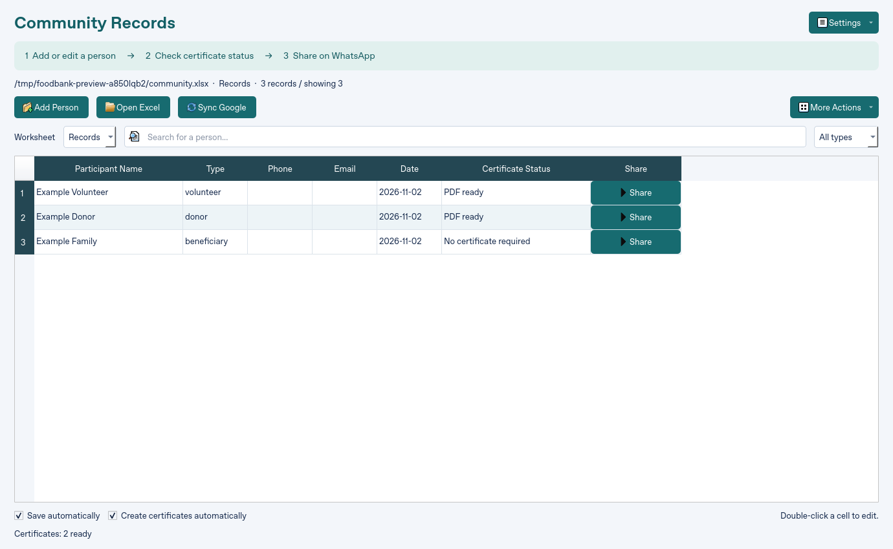

# Foodbank Community Admin

An English-language PySide6 desktop application using Excel as its database. Manage volunteers, donors, and beneficiary families; generate PDF certificates from PPTX templates; sync Google Sheets; and open WhatsApp for manual sharing. No Streamlit or web server is required.



## Windows: first run in VS Code

Install Python 3.12 or 3.13 (64-bit), VS Code with Microsoft's Python extension, and Microsoft PowerPoint or LibreOffice Impress for PDF export. PowerPoint generally preserves PowerPoint template formatting most accurately.

Download or clone this repository and open its root folder in VS Code. Open **Terminal → New Terminal**, select **Command Prompt**, and run:

```bat
py --version
py -m venv .venv
.venv\Scripts\python.exe -m pip install -r requirements.txt
.venv\Scripts\python.exe main.py
```

For subsequent launches, run `.venv\Scripts\python.exe main.py` or double-click `run.bat`. The batch file also installs any missing dependencies.

## Try the sample workflow

1. Click **Open Excel** and select `examples/sample_records.xlsx`. The sample contains three fictitious records and no real phone numbers. Changes are saved to the selected workbook, so copy it first if you want to keep a pristine sample.
2. Click **Settings → Certificate Templates**. Select `examples/volunteer_sample.pptx` for volunteers and `examples/donor_sample.pptx` for donors. Leave each name marker as `auto`.
3. Select `powerpoint` (or `auto`) on Windows with PowerPoint installed. Without PowerPoint, select `libreoffice`; if necessary, enter `C:\Program Files\LibreOffice\program\soffice.exe` as the executable path.
4. Click **More Actions → Generate / Retry PDFs**. Volunteers and donors should show **PDF ready**. Beneficiaries do not receive certificates.
5. Click **More Actions → Open PDF Folder** to inspect the output. Check fonts, layout, and long names before sending real certificates.
6. Use **Add Person** to enter another record. With **Save automatically** and **Create certificates automatically** checked, edits save about 1.4 seconds after typing stops and eligible certificates generate in the background.

Types are `volunteer`, `donor`, and `beneficiary`. Imported multilingual headings, names, and recognized type aliases are supported; user data is preserved as entered while application controls and messages are in English.

The main screen shows three everyday actions: **Add Person**, **Open Excel**, and **Sync Google**. Add Person opens a simple form with a type dropdown. Setup options are grouped under **Settings**; manual saving, reloading, PDF retries, and deleting rows are under **More Actions**. Icons always appear alongside text labels. The three-step guide explains the daily workflow: add/edit, check certificate status, then share.

## Excel records and column mapping

The default database is `data/community.xlsx`. **Open Excel** can select an existing `.xlsx` or `.xlsm` workbook; its first row is treated as column headings. **Settings → Worksheet Columns** selects the participant name, type, phone, and date columns. If a worksheet has no Type column, choose a default type for that worksheet.

Edit cells directly, press Tab to move between cells, search any field, filter by type, and paste multiple rows or columns from Excel with Ctrl+V. Ctrl+C copies selected cells. While a filter is active, paste fills existing visible rows; clear filters to paste additional rows.

This is a table editor, not a complete Excel replacement: it does not reproduce charts or merged-cell layouts or recalculate formulas. Unedited numeric, date, and formula cells retain their values. Newly entered text is stored as text rather than executed as a formula. Deleting rows may affect formula references or Excel tables.

The app adds hidden `__fb_id`, `__fb_source`, and `__fb_key` columns for stable record identity. Keep these columns and do not manually copy or change record IDs. Each actual write creates a backup in `<workbook_name>_backups`. Unchanged Google polling does not rewrite the workbook or create a backup. Backups do not expire automatically.

Saving uses a temporary file, atomic replacement, an application lock, and external modification checks. Use one administrator instance per workbook. If external changes conflict with unsaved edits, auto save pauses: copy your edits somewhere safe, then reload and resolve them. Close Excel if it locks the workbook. A stale `.foodbank.lock` file should only be removed after all app instances are closed.

## Certificate templates

The recipient name must be editable PPTX text, not text baked into an image. The `auto` marker detects the standalone word `name` (case-insensitive) or `{{NAME}}`, including markers split across text runs. Alternatively, enter the exact text to replace. Text boxes, grouped shapes, table cells, and layout/master text are supported. Optional markers are `{{DATE}}`, `{{TYPE}}`, and `{{ID}}`.

The original template is never edited. A temporary PPTX is filled and converted to a PDF under `data/certificates/volunteer` or `data/certificates/donor`. Generation is checked at startup, after saved edits, when external Excel changes are loaded, and after Google sync, across visible worksheets. Matching cached PDFs are reused; changes to names, dates, types, templates, or converter selection cause regeneration on the next check. Click **More Actions → Reload Excel** or **More Actions → Generate / Retry PDFs** after modifying a template file.

- `templates/volunteer_template.pptx` is the supplied original volunteer template.
- `examples/volunteer_sample.pptx` and `examples/donor_sample.pptx` are clearly labeled demonstration designs.
- An official donor template has not been supplied. Select your approved file in **Settings → Certificate Templates** before production use.
- Windows `auto` uses PowerPoint COM and requires PowerPoint and pywin32. On Linux/macOS, `auto` uses LibreOffice Impress.
- Missing templates/converters and export errors appear in the certificate status. Fix the prerequisite and click **More Actions → Generate / Retry PDFs**.
- Long names may overflow the original design; enlarge the text box or adjust template font sizes. LibreOffice and PowerPoint may render fonts and line breaks differently.
- Historical PDFs are retained. The Share action uses only a PDF whose signature matches the current record and template.

## Connect Google Forms / Google Sheets

1. Link Google Form responses to a Google Sheet.
2. Enable the **Google Sheets API** in Google Cloud, create a service account, and download its JSON key to a secure local location.
3. Share each Google Sheet with the JSON file's `client_email`, granting **Viewer** access. Never commit this key to GitHub.
4. Open **Settings → Google Sheets Connection**, select the credentials JSON, and add a source for each registration category. Enter the type, Sheet URL/ID, A1 range including its header row (for example `'Form Responses 1'!A1:ZZ`), and a separate local destination worksheet name (maximum 31 characters).
5. Enter the exact source headings for the name, phone, email, and date columns. Name is required; the others are optional. A unique, nonempty response ID column is strongly recommended.
6. Enable **Auto sync** (default interval: 60 seconds), or click **Sync Google** manually.

Source fields are retained as `Google · <original heading>` columns alongside normalized columns. Each source owns a separate local worksheet, which is read-only in the app. Add manual records in a local worksheet such as Records.

Sync is **Google → local Excel only**; it never writes to Google. Stable response IDs update existing records without duplicating them. Records removed from Google are not automatically deleted from local history. New volunteer/donor responses trigger certificate checks; beneficiaries are synced without certificates.

**Without a unique ID column, identity is based on Google row numbers: sources must be append-only. Do not sort, insert, or delete existing response rows.** Use a new destination worksheet when changing a source, registration type, or identity-column scheme. A timestamp is suitable only if it is truly unique.

Real access requires your credentials and sharing permissions. Network access to `oauth2.googleapis.com` and `sheets.googleapis.com` is required. Failures appear in the status area and automatic sync retries on the next interval; local Excel editing remains available.

## WhatsApp sharing

The last table column contains **Share**. Clicking it opens the recipient's chat. If a current PDF is ready, the app also opens its folder and copies the PDF path. **Attach the PDF and send manually in WhatsApp.** Ordinary WhatsApp links cannot attach local files automatically; no messages are sent automatically.

Default country code: Malaysia `60`. Local numbers starting with `0` are normalized accordingly; `+60...` and `0060...` are supported. Change the default with **Settings → WhatsApp Country Code**. Store phone numbers as Excel text to preserve leading zeros.

## Settings and recovery

Settings and the certificate index are stored in `data/settings.json` and `data/certificate_index.json`. Set `FOODBANK_DATA_DIR` to use another data directory. Back up that directory and the selected workbook. Corrupt settings/index JSON raises an error instead of silently overwriting it. Closing prompts for unsaved changes and waits for active background tasks; LibreOffice export has a 120-second timeout.

## Linux / macOS and development

Install Python and LibreOffice Impress, then run `bash run.sh`, or create a virtual environment and install `requirements.txt` manually. A desktop display is needed for interactive use. Headless validation uses Qt's offscreen backend:

```bash
QT_QPA_PLATFORM=offscreen .venv/bin/python -m unittest discover -s tests -v
# Include real PDF generation and name verification (requires poppler-utils):
QT_QPA_PLATFORM=offscreen FOODBANK_TEST_SOFFICE=/usr/bin/libreoffice .venv/bin/python -m unittest discover -s tests -v
```

Google tests use mocked API responses; they do not verify your live account. WhatsApp tests intercept browser calls and send no messages. Windows PowerPoint COM export must be checked on the target machine.

Code: `main.py` (English desktop UI/background tasks), `storage.py` (Excel), `certificates.py` (PPTX/PDF/share URLs), `google_sync.py` (Google read adapter), and `tests/`. `tools/create_examples.py` regenerates fictitious examples; `tools/package_source.py` packages the allowlisted source/assets without live records, credentials, caches, or virtual environments. This is Python source, not a Windows executable installer.
